<p align="center"></p>

# Panoptes

A pane for the [Hermes](https://hermes-agent.nousresearch.com) desktop app that shows what the agent is doing while it thinks. Tool calls, model steps, subagents and context use light up stations around a core, live, in a strip docked to the right edge of your workspace.

Named for Argus Panoptes, the all-seeing watchman of Greek myth. He belongs to the same pantheon as Hermes.

Based on [lot-map](https://github.com/alexeyw/lot-map), Aleksei Volodin's map panel for Claude Code. Same idea, new code: the original is written against the Claude Code plugin runtime, this one against the Hermes desktop plugin contract. No lines are shared, and the concept credit belongs upstream.

## What you get

Eight stations orbit a core labeled HERMES:

```
                YOU
        TOOLS            FILES
      MEMORY    HERMES    SHELL
        AGENTS            WEB
               BROWSER
```

At the center sits an eye. Its iris is the context gauge: teal while the window is quiet, amber past 70 percent, red past 90. Its pupil rests at center and glances toward whatever station is working, then drifts home; it blinks when a reply lands. Stations ride a dashed orbit ring, short ticks between eye and orbit wear thicker the more a station runs, and a slow sweep line turns behind everything like a watchtower radar. Every `tool.start` sends a pulse from the eye to the station that owns the tool. Completion sends it back. Failed calls leave a red dot at the station until the reply lands, and a folded feed below the map lists the last calls with durations.

Tool names map to stations like this:

| Station | Tools |
|---|---|
| FILES | `read_file`, `write_file`, `patch`, `search_files` |
| SHELL | `terminal`, `execute_code`, `process_manage` |
| WEB | `web_search`, `web_extract` |
| BROWSER | `browser_exec` |
| AGENTS | `delegate_task`, `cronjob*`, `subagent.*` events |
| MEMORY | `memory`, `lcm_*` |
| YOU | `clarify`, `todo_list` |
| TOOLS | everything else, including MCP tools |

The events consumed are `tool.start`, `tool.complete`, `message.delta`, `message.complete`, `session.usage`, `subagent.*`, `status.update` and `todo.updated` from the Hermes gateway.

A status-bar chip (bottom right) shows the running-call count and session totals while the pane is collapsed, and a totals line under the map carries call count and cumulative tokens from `session.usage`.

## Install

One command (Hermes 0.21.7 or newer):

```bash
hermes plugins install https://github.com/huwhitememes/panoptes --enable
```

Or manually: the package is a directory with `plugin.yaml` and `desktop/plugin.js`, so cloning it into the unified plugin directory is enough. No build step.

```bash
git clone https://github.com/huwhitememes/panoptes.git
cp -r panoptes ~/.hermes/plugins/panoptes
```

Restart Hermes if it is running, or toggle the pane in Settings, Plugins, Panoptes. The pane docks itself to the right edge of the workspace. A Motion toggle (full or reduced) lives in Settings, Plugins, Panoptes.

## Test

Two Node harnesses, no dependencies beyond a Hermes checkout:

```bash
node test/harness.mjs
```

Stubs the SDK imports, fires every gateway event the plugin listens to, asserts board state and the pane contribution.

```bash
HERMES_DESKTOP_DIR=~/.hermes/hermes-agent/apps/desktop node test/render-harness.mjs
```

Renders the pane with the real React and nanostores from the desktop app's `node_modules`. This is the one that matters. The first shipped version passed the logic harness and still crashed the pane: React 19's dev jsx runtime reads `config.children` unguarded, so a null config throws, and text passed as the third `jsx()` argument lands in the key slot and renders nothing. The rules this taught are written into the header of `plugin.js`.

The plugin itself is a single file, `plugin.js`, plain ESM. Imports are limited to `@hermes/plugin-sdk` and `react/jsx-runtime` because that is all the runtime loader allows.

## License

MIT, see [LICENSE](LICENSE). The original copyright line is preserved; the Hermes implementation is Copyright (c) 2026 Hu White.
